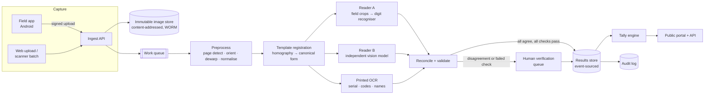

# Results Form Processing System — Design

Status: draft · Scope: Form 34A (presidential results at the polling station), extensible to 34B/34C and to other elective positions.

## 1. Problem

Polling station officials photograph a paper results form (Form 34A) and send the image. The system has to turn each image into structured, verified numbers, tally them by ward, constituency and county, and publish them. The tallies must be traceable back to the original image.

Three things make this harder than generic OCR:

1. **The numbers are the important part, and they are handwritten.** The printed parts (headers, station names, codes) are easy to read. The 14 numeric fields that matter are written by hand in many styles.
2. **The images are uncontrolled.** The five samples cover most of the failure modes we should expect:

   | Sample (serial) | Condition |
   |---|---|
   | FPE1011257 | Rotated 90°; I.E.B.C. stamp overlaps the disputed-votes table |
   | FPE1011215 | Very dark, green colour cast, low contrast; digits written without leader lines |
   | FPE1011221 | Upright and clean; book binding visible; stamp covers the declaration dates |
   | FPE1011239 | Rotated 90°; very large digits; stamp in a different ink colour |
   | FPE1011251 | Perspective skew; pen, books and other clutter in the frame |

3. **Wrong numbers that look plausible are the worst outcome.** A rejected image costs a reshoot. A misread `007` → `001` that gets accepted silently changes a result. The design aims for the lowest **false accept rate**, and accepts that some forms will go to a human.

The ground-truth numbers for the five samples are in [`sample-forms.json`](sample-forms.json). This is the start of the golden test set. The images themselves are not committed because they contain agents' names, ID numbers and phone numbers.

## 2. What the form gives us

Form 34A has a fixed printed layout. That is the most useful property for the design: we register each photo to a known template instead of doing free-form document understanding.

| Section | Fields | Type | Notes |
|---|---|---|---|
| Header | Form serial (`FPE1011221`) | Printed | Unique per sheet. Use it for deduplication and chain of custody. |
| Location | Station name, station code + stream (`001 - 2 of 4`), ward/constituency/county names and codes | Printed (pre-filled per station) | Checked against the master polling station register. |
| Candidate table | 8 candidate vote counts and the total valid votes | Handwritten, 3 digits, zero-padded, with a leader line | The core data. |
| Polling station counts | Registered voters, rejected, rejection objected to, disputed, total valid | Handwritten, 3 digits | Used for cross-checks. |
| Disputed votes | Up to 4 rows (serial, candidate assigned) | Handwritten / crossed out | Usually crossed out. |
| Declaration | Presiding officer and deputy names, signatures, dates, I.E.B.C. stamp | Handwritten + stamp | We check that they are present, not their content. |
| Agents | Up to 8 rows: name, ID, party, phone, signature, date | Handwritten | Used for the "agents signed" count. Contains personal data. |
| Refusal reasons / comments | Free text | Handwritten | Read with a lower priority; shown to reviewers. |

The forms contain several redundancies that we can check:

- Sum of candidate votes = **Total valid (candidate table)** = **Total valid (station counts, row 5)**: the same number is written twice.
- Leader lines (`———007`) and zero-padding are anti-tamper conventions. A digit with no padding, or with extra space to its left, is a signal worth flagging.
- All streams of one station (e.g. Mwaroni 1–4 of 4) should arrive, and they should share the station's location codes.

## 3. Architecture



All stages are stateless workers that read from a queue. Each one writes its output, keyed by image hash, to the results store. A stage can be rerun (e.g. with a better model) without re-ingesting anything.

### 3.1 Capture (field app)

The capture app is where we get the most benefit per unit of effort. A bad photo found on the device costs 10 seconds. A bad photo found at the tally centre can cost hours.

- **Live quality gate** before the shutter is accepted:
  - Page detection: four corners found and the page fills more than 60% of the frame (catches cases like FPE1011251).
  - Brightness and contrast: mean luminance and histogram spread (FPE1011215 would be rejected with "move to better light / turn on flash").
  - Blur: variance of the Laplacian over the candidate table region.
  - Glare: count of saturated pixels inside the page.
  - Orientation: no need to reject. The page is auto-rotated (FPE1011257 and FPE1011239 are fine once rotated).
- **On-device preview**: show the dewarped page so the officer can zoom into the numbers and confirm they are legible. This uses the `TouchImageView` component from this repository (pinch zoom, fling, double tap). Optionally run on-device digit reading and ask "We read Kenyatta = 045. Correct?", which catches capture problems early.
- **Metadata** attached to every upload: device ID (enrolled device), app-signed timestamp, GPS fix, the officer's login, and the expected station/stream (from the officer's assignment). The upload is signed with a device key provisioned at enrolment.
- **Offline-first**: queue locally and retry with backoff. Polling stations often have poor connectivity. Images are about 1–3 MB after JPEG quality 90; the full-resolution original is kept.
- **Multiple shots allowed**: an officer can send a better photo later. It attaches to the same form serial as a new *image version*. It does not create a new result.

### 3.2 Ingest

- Compute SHA-256 of the raw bytes and store the image **unmodified** in object storage with object lock (WORM). Every derived artefact references this hash.
- Verify the device signature and the officer's assignment. Unsigned uploads (web or scanner batch) are accepted but marked `provenance=unverified`.
- Deduplicate on the hash. The same bytes uploaded twice are a no-op.
- Enqueue a `process(image_hash)` job.

### 3.3 Preprocessing

1. **Page detection**: a learned quad detector (small segmentation net) with a classical fallback (Canny edges → largest 4-point contour). The fallback is fine for most images. The net handles the book-binding and clutter cases.
2. **Perspective correction**: warp the quad to a canonical A4 aspect ratio at a fixed resolution (e.g. 1654×2339 px, 200 dpi).
3. **Orientation**: try 0/90/180/270 and pick the rotation where the printed title "PRESIDENTIAL ELECTION RESULTS AT THE POLLING STATION" and the IEBC logo are found at the top. This is cheap and very reliable because the anchor text is printed.
4. **Photometric normalisation**: convert to grayscale using the channel with the best ink/paper contrast (blue ink vs. green security print), then apply CLAHE and background flattening (divide by a large-kernel blur). This step recovers FPE1011215.
5. **Security-print suppression**: the form has a fine guilloche background. A morphological opening plus a colour mask removes most of it before reading digits.

### 3.4 Template registration

- For each form type, keep a template: a clean scan, a set of anchor features (table grid lines, printed labels), and the bounding box of every field in canonical coordinates.
- Detect the table grid lines (Hough or a line-segment detector) and the printed labels, match them to the template, and fit a homography with RANSAC. Residual error above a threshold → `registration_failed`, and the form goes to a human with the full image.
- After registration, every field is a fixed crop. This removes most of the variation between images.
- **Template versioning**: the form's serial prefix (`FPE`) and the printed `r.79(2)(a)` reference identify the template. A new form design means a new template, not new code.

### 3.5 Reading the fields

Two **independent** readers per numeric field. Independence matters: if they make the same mistakes, agreement between them proves nothing.

**Reader A: specialised digit recogniser**
- Input: a registered field crop, with the leader line removed (it is a long horizontal stroke, easily detected).
- Model: a small CRNN with CTC over the digit alphabet `0-9` plus blank. It is trained on synthetic handwritten digits rendered onto real form backgrounds, then fine-tuned on hand-labelled crops from real forms.
- Output: digit string plus per-character confidence. Strings that are not 1–3 digits are treated as unreadable.

**Reader B: general vision model**
- Input: the dewarped full page, with a prompt that asks for a fixed JSON schema (the same fields as `sample-forms.json`). Example: a Claude model with a structured-output tool definition.
- Seeing the whole form gives it context that Reader A lacks, e.g. reading a smudged total from the sum of the candidate votes. This is also a risk, because it can "correct" a field that is genuinely inconsistent. To control that, the prompt says to transcribe exactly what is written, never to compute, and to return `null` for illegible fields.

**Printed OCR** (serial, codes, station name): standard OCR (Tesseract or a cloud OCR) on the registered printed fields. The result is checked against the master register. The serial number is printed in a known font at a known place, so accuracy is very high.

**Presence detectors** (cheap classifiers on crops):
- I.E.B.C. stamp present (circle detection on the declaration area, colour-agnostic: both blue and purple appear in the samples).
- Presiding officer and deputy signature boxes non-empty.
- Number of agent rows filled in (and signed).
- Disputed-votes table crossed out vs. filled in.

### 3.6 Reconciliation and validation

For each numeric field:

| Reader A | Reader B | Outcome |
|---|---|---|
| value, confidence ≥ τ | same value | `agreed` |
| value | different value | `conflict` → human |
| either one unreadable | — | `unreadable` → human |

Then the form-level checks run on the agreed values. Checks are **never used to fix a value**. The paper form is the legal record. If it is arithmetically wrong, we record that it is wrong; we do not record what it "should" say.

| # | Check | Severity |
|---|---|---|
| V1 | Σ candidate votes = total valid (candidate table) | Blocking |
| V2 | Total valid (candidate table) = total valid (station counts row 5) | Blocking |
| V3 | Total valid + rejected ≤ registered voters | Blocking |
| V4 | Station/ward/constituency/county codes exist and are consistent with each other in the master register | Blocking |
| V5 | Form serial not already bound to a different station/stream | Blocking |
| V6 | Registered voters equals the register's figure for that **stream** | Warning |
| V7 | Rejection objected to ≤ rejected | Warning |
| V8 | Disputed votes > 0 ⇒ disputed table filled in, and vice versa | Warning |
| V9 | Stamp present, presiding officer signature present | Warning |
| V10 | Upload GPS within N km of the station; device assigned to this station | Warning |
| V11 | Turnout or vote share is a statistical outlier vs. neighbouring streams of the same station and ward | Informational |
| V12 | A field has digits with no zero-padding or leader line (possible alteration) | Informational |

**Routing:**
- All numeric fields `agreed`, and no blocking check failed → **auto-verified**. Warnings stay attached and visible.
- Anything else → **human verification queue**, prioritised by how much the form's votes could change the tally (bigger stations first) and by age.

**Example from the samples:** all five forms pass V1–V3. For example FPE1011251: 1 + 2 + 46 + 3 = 52 = row 5, and 52 + 1 ≤ 598. All four Mwaroni streams report exactly **598** registered voters. If the register lists a different figure per stream, V6 fires on all four. Most likely the station total was copied onto each stream's form. That is not necessarily wrong for the vote counts, but it should be visible to observers and is exactly the kind of thing the system must surface rather than hide.

### 3.7 Human verification

The verification UI is designed so that people check numbers, not that they re-enter the whole form.

- For each flagged field, show the **crop** next to the candidate values from Reader A and Reader B. Clicking opens the full page, zoomed to that field (`TouchImageView` on the Android/tablet client; an equivalent zoom view on the web).
- **Blind double entry for conflicts**: two verifiers type the value *without* seeing the machine readings or each other's answer. If they agree, the field is resolved. If not, it goes to a supervisor. This avoids anchoring on a wrong machine value.
- The verifier can mark: "illegible" (request a reshoot from the field), "form physically altered", "wrong form for station". These create cases and do not edit numbers.
- Every action is an event with user ID, timestamp and the before/after state.
- Throughput target: about 20 s per flagged field and about 60 s per full form re-check.

### 3.8 Results store and data model

The store is event-sourced and append-only (PostgreSQL with an events table plus projections). Nothing is updated in place.

```
Station(station_code, stream, ward_code, constituency_code, county_code, name, registered_voters)
Submission(id, image_hash, device_id, officer_id, received_at, gps, provenance)
Image(hash, storage_uri, width, height, exif)
FormInstance(serial, form_type, template_version, station_code, stream)      -- one per paper sheet
FieldReading(form_serial, image_hash, field, reader, value, confidence, bbox)
Verification(form_serial, field, user_id, value, method[agree|double_entry|supervisor])
FormResult(form_serial, version, status[auto|human|disputed|superseded], values{}, flags[])
Flag(form_serial, check_id, severity, details)
AuditEvent(id, actor, action, entity, payload, at, prev_hash)               -- hash-chained
```

- `FormResult` is the only thing the tally reads. A new version (e.g. after a reshoot) supersedes the old one. The old one stays queryable.
- `AuditEvent` is hash-chained (each event includes the hash of the previous one). The chain head is published periodically, so tampering with history after the fact is detectable.

### 3.9 Tally

- The tally is a projection over the current `FormResult`s. It is recomputed incrementally on every new result.
- It reports **provisional** (auto + human verified) and **completeness** at each level: streams received / streams expected, and votes covered.
- Using only the five samples, the partial Gombato Bongwe ward tally would be:

  | Candidate | Mwakamba 1/1 | Mwaroni 1/4 | 2/4 | 3/4 | 4/4 | Total |
  |---|---|---|---|---|---|---|
  | Aukot | 0 | 0 | 0 | 0 | 1 | 1 |
  | Dida | 0 | 0 | 2 | 0 | 2 | 4 |
  | Jirongo | 0 | 0 | 0 | 0 | 0 | 0 |
  | Kaluyu | 0 | 0 | 0 | 0 | 0 | 0 |
  | Kenyatta | 7 | 33 | 45 | 33 | 46 | 164 |
  | Mwaura | 0 | 0 | 0 | 1 | 0 | 1 |
  | Nyagah | 0 | 0 | 0 | 0 | 0 | 0 |
  | Odinga | 2 | 4 | 1 | 1 | 3 | 11 |
  | **Valid** | 9 | 37 | 48 | 35 | 52 | **181** |
  | Rejected | 0 | 1 | 0 | 1 | 1 | 3 |

  Completeness: 5 / 5 streams for these two stations; ward completeness depends on the register.
- When the official 34B (constituency) form arrives, it is processed by the same pipeline with its own template. It is then **reconciled against our computed tally** of its 34As. Any difference is a flag at constituency level that names the specific stations involved.

### 3.10 Publication

- Public portal and read-only API: for each stream, the original image (with an optional redaction of agents' phone and ID numbers), the extracted numbers, the verification method (auto/human), the flags, and the image hash.
- Bulk download (CSV + images + hash manifest) so that observers and media can independently re-tally and verify.
- Every number on the portal links to the image crop it came from.

## 4. Non-functional requirements

| Concern | Approach |
|---|---|
| **Scale** | About 46,000 streams nationally × 1–3 images each, most of which arrive in a 6–12 h window. That is about 2–5 images/s at peak and under 300 GB of images. The pipeline is queue-based and autoscaled. GPU is needed only for Reader A and is optional (a CPU CRNN is fast enough at this rate). Reader B is rate-limited by the API quota, so it needs a reserved quota and a backlog alert. |
| **Latency** | Target: image → auto-verified result in under 2 minutes at p95. The human queue is sized so that 15–25% of forms can be routed (worse at first, improving as models are tuned). |
| **Integrity** | Signed uploads, WORM originals, hash-chained audit log, no in-place edits, role-based access (field officer / verifier / supervisor / admin). Two-person rule for supervisor overrides. |
| **Availability** | Multi-AZ. The ingest API accepts and stores uploads even if every downstream stage is down. |
| **Privacy** | Agents' ID and phone numbers are personal data. They are kept in the original image, and redacted from public derivatives according to policy. |
| **Observability** | Per-stage queue depth, processing time, auto-verify rate, conflict rate per field, verifier agreement rate, and reshoot rate per region and device. |

## 5. Measuring accuracy

- **Golden set**: a few thousand forms (from past elections and mock exercises) transcribed by blind double entry. [`sample-forms.json`](sample-forms.json) uses that format. It should cover the capture conditions listed in §1 in proportion to how often they occur.
- **Key metric: false accept rate**: the share of auto-verified forms with at least one wrong field. Target below 0.1%. Secondary metrics: auto-verify rate, and per-field accuracy of each reader.
- Gate every model or template change on the golden set. A rerun over historical images is cheap because all stages are keyed by image hash.
- **Before each election**: run a full mock with officials using the real app on blank forms filled with known numbers.

## 6. Build order

1. **MVP (manual first)**: capture app with quality gate, ingest + WORM storage, master register, double-entry verification UI, tally, portal. Every form is entered by humans. This works on day one and produces the training data.
2. **Machine reading**: preprocessing, template registration, Reader A + Reader B, and checks V1–V12. Machine readings start out as *suggestions* in the verification UI, and the agreement is measured against human entry.
3. **Auto-verification**: enable auto-accept once the measured false accept rate on the golden set and in shadow mode meets the target.
4. **Extensions**: other form types (34B/34C, other elective positions), reconciliation of 34B against the sum of 34As, observer API.

## 7. Open questions

- Is the registered voter figure on Form 34A meant to be per stream or per station? This decides whether V6 is a warning or informational (see the Mwaroni example).
- Is there an official allocation of form serial numbers to stations (booklet issue records)? If so, V5 can become "serial belongs to this station's booklet".
- Redaction policy for agent personal data in public images.
- Is an external vision model (Reader B) acceptable under data-residency rules, or does it need to be self-hosted?
